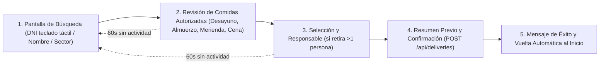

Este documento es una guía paso a paso para implementar el **Módulo de Entrega de Pedidos** (operado por el rol **Sector Comedor** en **Modo Kiosco**), respetando tanto la consigna del Trabajo Integrador 2026 como la arquitectura actual de la rama `development`.

> [!IMPORTANT]
> **Alcance de este documento:** Incluye el diagnóstico de lo que ya implementaron tus compañeros en el backend (`admin/`) y en el portal (`portal/`), los conceptos básicos de **Vue.js 3** necesarios para trabajar sin experiencia previa, los ajustes previos necesarios en la API para cumplir con las *Ampliaciones de la API* de la Etapa 2, y el paso a paso completo en el frontend.

---

## 1. Introducción y Resumen del Módulo

### ¿Cuál es el rol y el propósito de este módulo en el circuito?
El sistema digitaliza un circuito de tres instancias dentro del Hospital "Sor María Ludovica":
1. **Jefe de Servicio:** carga los pedidos nominados de su sector.
2. **Servicio de Alimentación:** revisa, ajusta y autoriza (o rechaza) esas solicitudes.
3. **Sector Comedor (tu módulo):** verifica en el momento qué comidas tiene autorizadas una persona para el día de hoy y **registra físicamente la entrega**, dejando constancia nominal de quién recibió la vianda y quién la retiró.

**Razón de negocio (Consigna págs. 1-2, 4-5, 46-50):**
- Evitar que una misma comida autorizada se entregue dos veces (error `409 Conflict`).
- Impedir que se entreguen comidas no autorizadas o de fechas distintas a la fecha actual.
- Permitir que una persona retire viandas para varias personas autorizadas (por ejemplo, un compañero que retira las viandas de todo un sector), dejando registrado **quién fue el responsable efectivo del retiro**.
- Ofrecer una interfaz **Modo Kiosco** optimizada para **tablets** (orientación vertical y horizontal), pensada para operarse de pie, solo con el tacto y a un brazo de distancia.

### Flujo lineal del Modo Kiosco



---

## 2. Conceptos Esenciales de Vue.js 3 (Guía Práctica)

El frontend está en [portal/](file:///d:/Documentos/FACULTAD/4to-año/Proyecto%20de%20Software/code/portal) y usa **Vue 3** (con `<script setup>` / *Composition API*), **Vite**, **Vue Router**, **Pinia** y **Axios**, según se ve en [package.json](file:///d:/Documentos/FACULTAD/4to-año/Proyecto%20de%20Software/code/portal/package.json).

### 2.1. ¿Qué es un archivo `.vue` (Single File Component)?
Cada pantalla o pieza reutilizable de la interfaz vive en un archivo `.vue` dividido en 3 bloques:
1. `<script setup>`: La lógica en JavaScript (variables reactivas, funciones, llamadas a la API). Todo lo que declares acá queda disponible automáticamente para el HTML de abajo.
2. `<template>`: La estructura HTML5 semántica de lo que ve el usuario.
3. `<style scoped>`: Los estilos CSS. La palabra `scoped` hace que ese CSS **aplique únicamente a ese componente**, evitando que tus estilos del Modo Kiosco rompan las pantallas de tus compañeros.

### 2.2. Reactividad: `ref()` y `computed()`
En Vue, la pantalla se actualiza sola cuando cambian los datos, pero solo si esos datos son **reactivos**:
- **`ref(valorInicial)`**: Crea una caja reactiva para guardar un estado (por ejemplo, el DNI escrito en el teclado, la comida activa o la lista de personas agregadas al retiro).
  - En `<script setup>`, para leer o modificar su valor usas `.value` (ej: `dni.value = '32123456'`).
  - En `<template>`, Vue desenvuelve el `.value` automáticamente, así que escribes solo `{{ dni }}`.
- **`computed(() => ...)`**: Crea un valor **calculado automáticamente** a partir de otros `ref`. Si cambian los datos base, Vue recalcula el `computed` solo.
  - Ejemplo en tu módulo: saber si el DNI tiene 7 u 8 dígitos para habilitar el botón "Buscar", o calcular cuántas viandas hay seleccionadas para el resumen antes de confirmar.

```vue
<script setup>
import { ref, computed } from 'vue'

const dni = ref('') // Estado reactivo del DNI ingresado

// Se recalcula automáticamente cada vez que cambia dni.value
const esDniValido = computed(() => /^\d{7,8}$/.test(dni.value))
</script>

<template>
  <!-- En el template NO se escribe .value -->
  <p>DNI ingresado: {{ dni }}</p>
  <button :disabled="!esDniValido">Buscar</button>
</template>
```

### 2.3. Directivas principales en el `<template>`
Las directivas son atributos especiales que empiezan con `v-` (o sus atajos `:` y `@`):
- **`v-if` / `v-else-if` / `v-else`**: Muestra u oculta un bloque HTML según una condición (ej: mostrar el spinner de carga mientras responde la API, mostrar el resumen previo solo cuando hay personas seleccionadas).
- **`v-for="(item, index) in lista" :key="item.id"`**: Repite un elemento HTML por cada ítem de un arreglo (ej: dibujar las teclas del `0` al `9`, listar las personas de un sector o las entregas del turno). El `:key` único es obligatorio para que Vue actualice la lista eficientemente.
- **`@click="miFuncion"`** (atajo de `v-on:click`): Ejecuta una función cuando el usuario toca un botón.
- **`:class="..."` / `:disabled="..."`** (atajo de `v-bind:`): Conecta atributos HTML con variables de JavaScript.
  - Ejemplo: `:disabled="cargando"` deshabilita el botón de "Confirmar entrega" mientras viaja la petición para evitar dobles envíos.
  - Ejemplo: `:class="['badge', estadoClase]"` cambia el color de la tarjeta según si la comida está `autorizada`, `entregada` o `no_autorizada`.

### 2.4. Comunicación entre Componentes: `defineProps` y `defineEmits`
Para no meter mil líneas de código en un solo archivo, dividirás la pantalla en componentes hijos (ej: `NumericKeypad.vue`, `PersonMealCard.vue`). La regla en Vue es: **los datos bajan por `props` y las acciones suben por `emits`**.
- **`defineProps`**: Declara qué datos recibe el componente hijo desde su padre (solo lectura).
- **`defineEmits`**: Declara qué eventos avisa el hijo al padre cuando el usuario interactúa (ej: `emit('buscar')` o `emit('agregar-digito', '5')`).

### 2.5. Ciclo de Vida: `onMounted` y `onUnmounted`
- **`onMounted(() => { ... })`**: Se ejecuta **una sola vez cuando la vista aparece en pantalla**. Acá es donde pedís los sectores a la API, cargas la configuración de horarios/healthcheck, traes las entregas del turno y arrancas los temporizadores (`setInterval`).
- **`onUnmounted(() => { ... })`**: Se ejecuta **cuando el usuario sale de la vista** (por ejemplo, al cerrar sesión). Sirve para limpiar intervalos (`clearInterval`) y `clearTimeout` de inactividad para que no queden procesos corriendo en memoria.

### 2.6. Vue Router, Pinia y Axios (ya configurados en `portal/`)
El equipo ya configuró la base en estos archivos:
- **Rutas ([router/index.js](file:///d:/Documentos/FACULTAD/4to-año/Proyecto%20de%20Software/code/portal/src/router/index.js)):** Define qué URL muestra cada `.vue` y protege las rutas con `router.beforeEach`.
- **Estado global de sesión ([stores/user.js](file:///d:/Documentos/FACULTAD/4to-año/Proyecto%20de%20Software/code/portal/src/stores/user.js)):** Usa Pinia (`useAuthStore()`) con persistencia en almacenamiento local (`pinia-plugin-persistedstate`) para recordar `state.isLoggued` y `state.usuario` (`id`, `nombre`, `apellido`, `email`, `rol`, `sector_asociado`).
- **Cliente HTTP único ([services/api.js](file:///d:/Documentos/FACULTAD/4to-año/Proyecto%20de%20Software/code/portal/src/services/api.js)):** Crea `apiService` con `axios.create` apuntando a `VITE_API_URL`, agrega automáticamente `Authorization: Bearer <token>` en cada request e intercepta errores `401` para redirigir al login.

---

## 3. Diagnóstico Actual y Ajustes Previos en el Backend (`admin/`)

Al analizar la rama `development`, la mayor parte de la API de Etapa 1 para entregas ya existe en [entregas.py](file:///d:/Documentos/FACULTAD/4to-año/Proyecto%20de%20Software/code/admin/src/web/controllers/entregas.py), [autorizaciones.py](file:///d:/Documentos/FACULTAD/4to-año/Proyecto%20de%20Software/code/admin/src/web/controllers/autorizaciones.py) y [pedidos.py](file:///d:/Documentos/FACULTAD/4to-año/Proyecto%20de%20Software/code/admin/src/core/services/pedidos.py). Sin embargo, **la consigna de la Etapa 2 (págs. 53-59) introdujo ampliaciones y aclaraciones de negocio** que aún no están reflejadas del todo en el backend.

> [!WARNING]
> **Coordinación con el equipo:** Antes de hacer cambios en `admin/`, coordina con tus compañeros (especialmente con quien esté tocando `pedidos.py` o `configuracion.py`) para no pisar trabajo ni romper endpoints de los otros módulos.

### Paso 0.1: Agregar usuario de prueba `Sector Comedor` en los Seeds
- **Qué ocurre hoy:** En [seeds.py](file:///d:/Documentos/FACULTAD/4to-año/Proyecto%20de%20Software/code/admin/src/core/seeds.py#L115-L148) se crea el rol `'Sector Comedor'` con todos sus permisos (`autorizados_index`, `autorizados_show`, `entregas_index`, `entregas_show`, `entregas_new`, `entregas_summary`, `sector_show_api`, `sector_index_api`, `personal_index_api`, `personal_show_api`, `auth_me`, etc.), pero **no se crea ningún usuario con ese rol** (solo existen `admin@admin.com`, `jefeserv@jefe.com` y `gonzamayo06@gmail.com`).
- **Qué hacer:** Agregar en `seeds.py` un usuario inicial con rol `'Sector Comedor'` (y si hace falta probar entregas directamente, un pedido de prueba con solicitudes en estado `Autorizado` para `date.today()`).
- **Motivo:** Sin un usuario con rol `Sector Comedor` en la base de datos no podrás loguearte en el portal para desarrollar ni probar tu vista.

### Paso 0.2: Completar datos en `GET /api/authorized-meals` y revisar `RecibirFecha`
- **Qué ocurre hoy:**
  1. `GET /api/authorized-meals` ([autorizaciones.py](file:///d:/Documentos/FACULTAD/4to-año/Proyecto%20de%20Software/code/admin/src/web/controllers/autorizaciones.py#L211-L254) y `get_pedidos_autorizados` en [pedidos.py](file:///d:/Documentos/FACULTAD/4to-año/Proyecto%20de%20Software/code/admin/src/core/services/pedidos.py#L736-L787)) solo consulta `EstadoSolicitud.estado_id == autorizado`, por lo que **no devuelve las comidas ya entregadas** ni incluye el **tipo de menú** (`menu_id` / `menu_nombre`), ni el **estado** (`Autorizado` / `Entregado`), ni el `pedido_id`.
  2. Por contraste, `GET /api/authorized-meals/{person_id}` (`get_solicitudes_from_personal` en [pedidos.py](file:///d:/Documentos/FACULTAD/4to-año/Proyecto%20de%20Software/code/admin/src/core/services/pedidos.py#L789-L822)) sí trae `pedido_id`, `solicitud_id`, `menu`, `comida` y `estado` (tanto `Autorizado` como `Entregado`).
  3. En [schemas/pedidos.py](file:///d:/Documentos/FACULTAD/4to-año/Proyecto%20de%20Software/code/admin/src/web/schemas/pedidos.py#L189), `RecibirFecha` define `load_default=datetime.today()`. En Python, llamar a `datetime.today()` al definir la clase congela la fecha al momento en que arrancó el servidor Flask.
- **Motivo (Consigna págs. 31-32, 48-49):**
  - El comedor necesita ver en el listado por sector o búsqueda por DNI/Nombre: qué tipo de menú tiene autorizado cada persona (`General`, `Vegetariano`, `Celíaco`) y distinguir **autorizadas pendientes** vs **ya entregadas** para evitar intentar entregar dos veces.
- **Qué hacer:**
  1. Actualizar `get_pedidos_autorizados` y `RetornarSolicitudesAutorizados` en [schemas/pedidos.py](file:///d:/Documentos/FACULTAD/4to-año/Proyecto%20de%20Software/code/admin/src/web/schemas/pedidos.py#L214-L226) para incluir `pedido_id`, `menu_id`, `menu_nombre` y `estado` (filtrando `Autorizado` o `Entregado`, o permitiendo filtrar pendientes).
  2. Cambiar `load_default=datetime.today()` a `load_default=date.today` (pasando la función sin paréntesis) en `RecibirFecha`.

### Paso 0.3: Adecuar `POST /api/deliveries` a las Ampliaciones de la API (Etapa 2)
- **Qué ocurre hoy:** En [entregas.py](file:///d:/Documentos/FACULTAD/4to-año/Proyecto%20de%20Software/code/admin/src/web/controllers/entregas.py#L88-L171) y [schemas/entregas.py](file:///d:/Documentos/FACULTAD/4to-año/Proyecto%20de%20Software/code/admin/src/web/schemas/entregas.py#L5-L14):
  1. Exige obligatoriamente `pedido_id` único en el JSON. Si agregas a un mismo retiro a dos personas de distintos pedidos o sectores (por ejemplo un residente y un personal fijo), un único `pedido_id` se queda corto.
  2. Exige siempre `nombre_retirador` o `retirador_id`, incluso cuando retira **una sola persona**.
  3. No recibe ni valida el **DNI del tercero** que retira en representación de otras personas.
  4. Al devolver `409` en `is_solicitud_entregado(solicitud)`, solo dice `"Solicitud {id} ya entregado"` sin indicar el nombre de la persona ni la comida.
- **Motivo (Consigna págs. 49 y 58-59):**
  - *"La entrada ya no incluye el tipo de menú entregado. El servidor lo toma de la solicitud autorizada de cada persona."* (Esto ya lo hace bien el backend actual al guardar la entrega por `solicitud_id`).
  - *"El responsable es obligatorio cuando el retiro incluye más de una persona; si incluye una sola, esa persona es el responsable por defecto."*
  - *"Si se trata de un tercero que no está registrado como personal, su DNI y su nombre y apellido. Errores adicionales: 400 si falta el responsable en un retiro de varias personas o si el DNI del tercero no tiene un formato válido."*
  - *"Si la API responde con 409, la interfaz deberá indicar qué persona y qué comida ya fueron entregadas."*
- **Qué hacer:**
  - Permitir que `pedido_id` sea inferido desde cada `solicitud` en la base de datos (verificando para cada una que su sector esté activo, que la fecha sea hoy y que esté autorizada).
  - Si `len(solicitudes) == 1` y no se envió retirador, asignar automáticamente como `retirador_id` el `personal_id` de esa única solicitud (o si se quiere soportar que una sola persona retire varias comidas en un mismo acto, verificar cuántas `personal_id` distintas hay en las solicitudes).
  - Si hay más de una persona y falta responsable (`retirador_id` y datos del tercero), devolver `400`.
  - Si retira un tercero (`dni_retirador` + `nombre_retirador`), validar el formato numérico del DNI (ej. 7-8 dígitos) antes de guardar y devolver `400` si es inválido.
  - En el error `409` por comida ya entregada, devolver el nombre/apellido de la persona y el nombre de la comida (ej: `{"error": "...", "persona": "María Solís", "comida": "Almuerzo"}`) para que el frontend lo muestre claramente.

### Paso 0.4: Corregir `obtener_entrega_summary` y enriquecer `obtener_entregas`
- **Qué ocurre hoy en [pedidos.py](file:///d:/Documentos/FACULTAD/4to-año/Proyecto%20de%20Software/code/admin/src/core/services/pedidos.py#L897-L1049):**
  1. En `obtener_entrega_summary` (líneas 1009-1046): si se filtra por `sector_id`, hace `stmt.where(Pedido.sector_id == sector_id)` **pero falta hacer `.join(Solicitud.pedido)`**, lo cual generará un error SQL o producto cartesiano al usar ese filtro. Además, cuando una solicitud pasa de `Autorizado` a `Entregado`, `EstadoSolicitud` agrega una nueva fila (una fila histórica con `estado_id = autorizado` y otra nueva con `estado_id = entregado`), por lo que conviene verificar si debe contar sobre `Solicitud.estado_actual` (donde `total_autorizados` = `Autorizado + Entregado` y `total_entregados` = `Entregado`) para no contar dos veces estados históricos si alguna vez se corrigió una autorización.
  2. En `obtener_entregas` (líneas 897-954): devuelve `Solicitud.fecha` y solo `PersonalPersona.nombre` (sin `apellido` ni la hora exacta `EstadoSolicitud.fecha` de la entrega).
- **Qué hacer:** Agregar `.join(Solicitud.pedido)` en `obtener_entrega_summary` y exponer `apellido` y la fecha/hora real de entrega (`EstadoSolicitud.fecha`) en `obtener_entregas` (y opcionalmente filtro por `pag` / total de páginas como en otros listados).

### Paso 0.5: Coordinar `GET /api/configuration` (Horarios, Mantenimiento y HealthCheck)
- **Qué ocurre hoy:** En [ajustes.py](file:///d:/Documentos/FACULTAD/4to-año/Proyecto%20de%20Software/code/admin/src/core/models/ajustes/ajustes.py) solo existen `paginacion`, `mantenimiento` y `mensaje`. Aún no está expuesto `GET /api/configuration` con los horarios de inicio/fin de cada comida (Desayuno, Almuerzo, Merienda, Cena).
- **Motivo (Consigna págs. 47, 52, 54):**
  - *"Mostrar en forma destacada la comida en curso (desayuno, almuerzo, merienda o cena), determinada por la hora y los horarios configurados, con la posibilidad de cambiarla manualmente."*
  - *"Informar en pantalla si se pierde la conexión con la API, en lugar de quedar sin respuesta (por ejemplo, implementando en la API un healthCheck)."*
- **Qué hacer:** Coordinar con el compañero que implementa "Modo mantenimiento y configuración" para que `GET /api/configuration` (público, sin token) devuelva el estado de mantenimiento y los horarios de comida, o en su defecto agregar un endpoint liviano `GET /api/health` que responda `{"status": "ok"}` con `200`.

---

## 4. Plan de Implementación Paso a Paso en el Frontend (`portal/`)

A continuación tienes el orden recomendado de trabajo en `portal/`. Todos los textos visibles deberán estar en **español** y las fechas en formato **`dd/mm/aaaa`** (Consigna pág. 53).

### Paso 1: Crear el servicio de comunicación con la API (`services/deliveries.js`)
- **Objetivo:** Centralizar todas las peticiones HTTP del módulo en un único archivo de servicio, sin escribir URLs ni `axios` directamente dentro de los componentes `.vue`.
- **Motivo (Consigna págs. 37-38, 50):**
  > *"Centralizar las llamadas a la API en un único cliente HTTP... Organizar el código por módulo (carga de pedidos, autorización, entrega y reportes), separando vistas, componentes reutilizables y servicios de acceso a la API."*
- **Cómo funciona en Vue/JS:**
  Usaremos el cliente `apiService` ya creado en [services/api.js](file:///d:/Documentos/FACULTAD/4to-año/Proyecto%20de%20Software/code/portal/src/services/api.js). Ese cliente ya lee `VITE_API_URL`, ya inyecta `Authorization: Bearer <token>` en cada petición y ya captura el `401` si vence el token.
- **Archivo a crear:** `portal/src/services/deliveries.js`

```javascript
// portal/src/services/deliveries.js
import { apiService } from '@/services/api.js'

/**
 * Busca personal activo por DNI, nombre o apellido.
 */
export const buscarPersonal = (params) =>
  apiService.get('/personnel', { params })

/**
 * Consulta comidas autorizadas/entregadas según filtros (fecha, dni, nombre, apellido, sector, comida).
 */
export const obtenerComidasAutorizadas = (params) =>
  apiService.get('/authorized-meals', { params })

/**
 * Consulta todas las comidas (desayuno/almuerzo/merienda/cena) de una persona para una fecha.
 */
export const obtenerComidasDePersona = (personId, fecha) =>
  apiService.get(`/authorized-meals/${personId}`, { params: { fecha } })

/**
 * Registra la entrega física de una o varias comidas en una misma operación.
 */
export const registrarEntrega = (payload) =>
  apiService.post('/deliveries', payload)

/**
 * Lista las entregas realizadas (idealmente filtradas por fecha actual y comida del turno).
 */
export const listarEntregas = (params) =>
  apiService.get('/deliveries', { params })

/**
 * Obtiene el detalle de una entrega específica.
 */
export const obtenerDetalleEntrega = (deliveryId) =>
  apiService.get(`/deliveries/${deliveryId}`)

/**
 * Obtiene totales autorizados vs entregados del día, discriminados por comida y menú.
 */
export const obtenerResumenEntregas = (params) =>
  apiService.get('/deliveries/summary', { params })

/**
 * Lista sectores activos para el modo "Grupo por sector".
 */
export const listarSectores = (params) =>
  apiService.get('/sectors', { params })

/**
 * Consulta parámetros generales (horarios de comidas, mantenimiento) y sirve como healthCheck.
 */
export const obtenerConfiguracion = () =>
  apiService.get('/configuration')
```

---

### Paso 2: Configurar la ruta, los permisos por rol y el Layout de Modo Kiosco
- **Objetivo:** Hacer que al iniciar sesión con el rol `Sector Comedor` el usuario vaya directo a `/kiosco`, bloquear el acceso a otros roles, y **ocultar la barra de navegación general de la app** en el modo kiosco.
- **Motivo (Consigna págs. 38-40, 46):**
  - *"Redirigir a cada usuario a la pantalla inicial de su rol: Sector Comedor: pantalla de búsqueda del modo kiosco."*
  - *"La vista del Sector Comedor utilizará un layout propio de modo kiosco, sin menú lateral, descripto en el Módulo de Entrega de pedidos."*
  - *"Ocupar toda la pantalla, sin menú lateral, barra de navegación ni opciones ajenas a la entrega de comidas."*
- **Cómo funciona en Vue Router:**
  Cada objeto de ruta en [router/index.js](file:///d:/Documentos/FACULTAD/4to-año/Proyecto%20de%20Software/code/portal/src/router/index.js) admite una propiedad `meta`. Allí podemos guardar `roles: ['Sector Comedor']` y `kioskMode: true`. En `router.beforeEach(to)`, comparamos `state.usuario.rol` contra `to.meta.roles`. En [App.vue](file:///d:/Documentos/FACULTAD/4to-año/Proyecto%20de%20Software/code/portal/src/App.vue), leemos `$route.meta.kioskMode` para decidir si renderizamos o no el `<header>` común.
- **Archivos a revisar/modificar (coordinando con el equipo):**
  1. [router/index.js](file:///d:/Documentos/FACULTAD/4to-año/Proyecto%20de%20Software/code/portal/src/router/index.js):
     - Registrar la ruta `/kiosco` (lazy-loaded con `() => import('@/views/entregas/KioskDeliveryView.vue')`) con `meta: { requiresAuth: true, roles: ['Sector Comedor'], kioskMode: true }`.
     - Agregar verificación de roles en `router.beforeEach` y redirigir a una vista de "Acceso denegado" si otro rol intenta entrar a `/kiosco`.
  2. [LoginView.vue](file:///d:/Documentos/FACULTAD/4to-año/Proyecto%20de%20Software/code/portal/src/views/LoginView.vue#L19):
     - Hoy hace `router.replace(route.query.redirect || '/')`. Actualizarlo para que, si no hay `redirect`, redirija según `state.usuario.rol` (si es `'Sector Comedor'`, ir a `{ name: 'kiosco' }`).
  3. [App.vue](file:///d:/Documentos/FACULTAD/4to-año/Proyecto%20de%20Software/code/portal/src/App.vue#L17-L31):
     - Envolver el `<header>` general con `v-if="!$route.meta.kioskMode"` para que en el modo kiosco desaparezcan los enlaces de Home/About/Navbar.
  4. [main.css](file:///d:/Documentos/FACULTAD/4to-año/Proyecto%20de%20Software/code/portal/src/assets/main.css#L24-L31) y [base.css](file:///d:/Documentos/FACULTAD/4to-año/Proyecto%20de%20Software/code/portal/src/assets/base.css#L62-L64):
     - Hoy tienen estilos heredados de la plantilla inicial de Vite (`body { display: flex; place-items: center; }` y `main { margin: 5rem; }`). En el kiosco eso achicaría la pantalla; hay que removerlos o anularlos para que la vista ocupe todo el alto y ancho disponible.

> [!NOTE]
> **Detalle observado en [stores/user.js](file:///d:/Documentos/FACULTAD/4to-año/Proyecto%20de%20Software/code/portal/src/stores/user.js#L16) y [services/api.js](file:///d:/Documentos/FACULTAD/4to-año/Proyecto%20de%20Software/code/portal/src/services/api.js#L37):**
> En `removeAuth()` dice `localStorage.setItem("token", null)` (en lugar de `localStorage.removeItem("token")`), lo cual guarda la cadena `"null"` si no se limpia bien. Además, `POST /api/auth/logout` no se está llamando todavía desde el botón de cerrar sesión (consigna pág. 39). Asegúrate de que tu botón de cerrar sesión del kiosco llame a `POST /api/auth/logout` y luego limpie el token y el store.

---

### Paso 3: Cabecera del Kiosco, Detección de Comida en Curso y HealthCheck
- **Objetivo:** Construir la barra superior compacta del kiosco (`KioskHeader.vue`) que muestra el turno/comida activa, el estado de conexión con la API y los accesos discretos de la esquina.
- **Motivo (Consigna págs. 46-47):**
  - *"Mostrar en forma destacada la comida en curso (desayuno, almuerzo, merienda o cena), determinada por la hora y los horarios configurados, con la posibilidad de cambiarla manualmente."*
  - *"Ofrecer un acceso discreto, por ejemplo un ícono en una esquina, para consultar las entregas del turno, ver los totales del día y cerrar sesión."*
  - *"Informar en pantalla si se pierde la conexión con la API, en lugar de quedar sin respuesta (por ejemplo, implementando en la API un healthCheck)."*
- **Cómo funciona en Vue:**
  - En `onMounted`, obtienes los horarios desde `obtenerConfiguracion()` (o usas un rango horario por defecto si el endpoint aún no devuelve horarios, ej: Desayuno `06:00-10:30`, Almuerzo `11:00-14:30`, Merienda `15:00-18:30`, Cena `19:00-23:30`) y calculas la comida inicial comparando con `new Date()`.
  - Guardas esa comida en un `ref('Almuerzo')` (o por su ID `1..4`) para que el usuario pueda tocar otro botón táctil (`Desayuno`, `Almuerzo`, `Merienda`, `Cena`) si necesita entregar fuera de horario.
  - Creas un `setInterval` cada 30 segundos en `onMounted` (y lo limpias en `onUnmounted`) que consulta el endpoint de healthcheck/configuración. Además escuchas `window.addEventListener('offline', ...)` y `'online'`. Si falla la red o el servidor no responde, un `ref(false)` llamado `apiOnline` muestra un banner rojo fijo arriba: *"Sin conexión con el servidor. Verificando conexión..."*.

---

### Paso 4: Teclado Numérico Táctil y Buscador Múltiple (DNI, Nombre y Sector)
- **Objetivo:** Permitir que el operador del comedor busque rápidamente sin usar teclado físico ni abrir el teclado molesto del sistema operativo de la tablet.
- **Motivo (Consigna págs. 47-48):**
  - *"Mostrar un teclado propio con los dígitos del 0 al 9, una tecla para borrar el último dígito, otra para limpiar el campo y otra para buscar (idealmente evitar que se abra el teclado del sistema operativo de la tablet al tocar el campo de DNI)."*
  - *"Validar mientras se escribe que el DNI contenga solo números y tenga una longitud válida."*
  - *"Buscar una o varias personas mediante DNI y, como alternativa, por nombre o apellido."*
  - *"Buscar por sector para listar las personas de ese sector con comidas autorizadas pendientes y seleccionar varias en una misma operación, para agilizar el caso en que una persona retira las viandas de su sector."*
- **Cómo implementarlo en Vue:**
  1. **Pestañas táctiles grandes** en la parte superior del buscador (similar al mockup de la pág. 48 de la consigna):
     - Modo 1: **Por DNI** (muestra el campo de solo lectura `readonly` + `inputmode="none"` y el componente `NumericKeypad.vue`).
     - Modo 2: **Por Nombre / Apellido** (alternativa con `<input type="text">` tradicional para casos donde no se recuerda el DNI, con lista de resultados tocables para agregar).
     - Modo 3: **Grupo por Sector** (muestra botones grandes de los sectores activos obtenidos de `GET /api/sectors`; al tocar un sector, llama a `GET /api/authorized-meals` con `sector` y `fecha` de hoy para listar todas las personas con viandas autorizadas pendientes de ese sector, con un botón *"Seleccionar todas las pendientes"* o selección individual con un toque).
  2. **Componente hijo `portal/src/components/entregas/NumericKeypad.vue`:**
     - Recibe `modelValue` (el texto del DNI) por `defineProps` y emite eventos (`update:modelValue`, `buscar`) por `defineEmits`.
     - Botones con `min-width: 64px; min-height: 64px` (supera el mínimo de `48x48px`) dispuestos en una grilla CSS `grid-template-columns: repeat(3, 1fr)` con `gap: 12px`.
     - Impide ingresar más de 8 dígitos y deshabilita el botón **Buscar** si hay menos de 7 dígitos, mostrando una etiqueta de ayuda en vivo (`"Ingresá entre 7 y 8 números"`).

```vue
<!-- Ejemplo simplificado de NumericKeypad.vue -->
<script setup>
const props = defineProps({
  modelValue: { type: String, default: '' },
  disabled: { type: Boolean, default: false }
})
const emit = defineEmits(['update:modelValue', 'buscar'])

const agregarDigito = (digito) => {
  if (props.modelValue.length >= 8) return
  emit('update:modelValue', props.modelValue + digito)
}
const borrarUltimo = () => {
  emit('update:modelValue', props.modelValue.slice(0, -1))
}
const limpiar = () => {
  emit('update:modelValue', '')
}
</script>
```

---

### Paso 5: Tarjetas de Comidas Autorizadas y Lista de Retiro (`PersonMealCard.vue`)
- **Objetivo:** Mostrar claramente qué comidas del día tiene la persona buscada, su tipo de menú, su estado (con color + ícono + texto), y permitir agregar una o varias personas a la operación de retiro actual.
- **Motivo (Consigna págs. 47, 48-49):**
  - *"Textos legibles a un brazo de distancia. El DNI, el nombre de la persona y sus comidas autorizadas deberán ser los elementos más destacados."*
  - *"La pantalla no deberá mostrar más datos personales que los necesarios para identificar a la persona."* (Solo Nombre, Apellido, DNI y Sector).
  - *"Indicar el estado de cada comida con color, ícono y texto a la vez (autorizada pendiente, entregada o no autorizada), para que se distinga aunque no se perciban los colores."*
  - *"Visualizar el tipo de menú autorizado... El tipo de menú entregado es el que figura en la autorización: la interfaz no lo envía ni permite cambiarlo."*
  - *"Agregar varias personas a una misma operación de retiro... Seleccionar las comidas a entregar de cada persona incluida."*
- **Reglas de diseño en este paso:**
  - Al encontrar una persona (por DNI o nombre), llamar a `obtenerComidasDePersona(persona.id, fechaHoy)` (`GET /api/authorized-meals/{person_id}`) y cruzar con las 4 comidas fijas (`Desayuno`, `Almuerzo`, `Merienda`, `Cena`):
    1. Si aparece en estado **`Autorizado`**: Badge **Verde** + ícono **`✓`** + texto **`"Autorizada pendiente"`** + badge del menú (`General` / `Vegetariano` / `Celíaco`). Es **seleccionable** con un toque (checkbox/botón grande >= 48x48px). Si coincide con la comida en curso del turno, puedes dejarla preseleccionada por defecto para ahorrar un toque al operador.
    2. Si aparece en estado **`Entregado`**: Badge **Gris/Azul** + ícono **`✓✓`** + texto **`"Ya entregada"`** + menú. Está **bloqueada** (no seleccionable).
    3. Si **no aparece** en el resultado del día: Badge **Rojo/Neutro** + ícono **`✕`** + texto **`"No autorizada"`**. Está **bloqueada**.
  - Mantener en la vista principal un `ref([])` llamado `listaRetiro` que acumule las personas agregadas junto con las `solicitud_id` seleccionadas para entregar. Si se busca otra persona, se la puede sumar a `listaRetiro` (evitando duplicar la misma persona dos veces) y quitar con un botón táctil `"Quitar"`.

---

### Paso 6: Designación de Responsable, Resumen Previo y Confirmación (`DeliverySummaryModal.vue`)
- **Objetivo:** Verificar quién retira, mostrar un resumen final legible antes de confirmar, enviar `POST /api/deliveries` y manejar respuestas exitosas o conflictos `409`.
- **Motivo (Consigna págs. 41, 49, 58-59):**
  - *"Pedir confirmación antes de las operaciones que no se pueden deshacer: ... confirmar una entrega."*
  - *"Evitar envíos duplicados deshabilitando los botones de acción mientras la solicitud está en curso."*
  - *"Cuando el retiro incluya varias personas, designar a un responsable del retiro, que podrá ser una de las personas incluidas o un tercero identificado por DNI y nombre."*
  - *"Si incluye una sola, esa persona es el responsable por defecto."*
  - *"No se podrá entregar dos veces la misma comida autorizada. Si la API responde con 409, la interfaz deberá indicar qué persona y qué comida ya fueron entregadas."*
- **Qué debe hacer la lógica del componente:**
  1. **Cálculo de responsable con `computed`:**
     - Si `personasEnRetiro.length === 1`: muestra por defecto *"Retira: [Nombre Apellido de la persona]"* (con opción opcional por si retira un tercero en su nombre).
     - Si `personasEnRetiro.length > 1`: bloquea el botón de confirmar hasta que el operador elija una de dos opciones táctiles:
       - **Opción 1 (Alguien del grupo):** Botones táctiles con el nombre de cada persona incluida (`retirador_id`).
       - **Opción 2 (Tercero no incluido):** Formulario con `<label>` claro para **DNI del tercero** (validado en el cliente: solo números, 7-8 dígitos) y **Nombre y Apellido del tercero** (requerido, solo letras y espacios).
  2. **Paso de Resumen Previo:**
     - Lista cada persona incluida, qué comida(s) se le entregan, qué menú le corresponde a cada una (solo lectura) y el nombre del responsable del retiro.
  3. **Envío y Manejo de Errores HTTP (Consigna pág. 41):**
     - Poner `enviando.value = true` antes del `await registrarEntrega(payload)` y `false` en el `finally`.
     - **201 Created:** Mostrar pantalla/alerta verde grande de éxito (*"Entrega registrada a las HH:mm"*), refrescar el panel de entregas recientes del turno y los totales del día, y lanzar el timer de vuelta al inicio (Paso 7).
     - **400 Bad Request:** Mostrar el mensaje de validación de la API junto al campo que falló (ej. DNI de tercero inválido).
     - **401 Unauthorized:** Lo maneja el interceptor de [api.js](file:///d:/Documentos/FACULTAD/4to-año/Proyecto%20de%20Software/code/portal/src/services/api.js) cerrando sesión y volviendo al login.
     - **403 Forbidden / 404 Not Found:** Mostrar alerta clara en pantalla.
     - **409 Conflict:** Mostrar alerta destacada indicando **qué persona y qué comida ya fueron entregadas** y recargar automáticamente las comidas de las personas involucradas para reflejar su estado real `"Ya entregada"`.
     - **503 Service Unavailable:** Mostrar la vista/overlay de sitio en mantenimiento.
     - **500 / Error de Red:** Mostrar mensaje genérico con un botón grande de **"Reintentar"** sin perder los datos seleccionados.

---

### Paso 7: Vuelta Automática al Inicio y Temporizador de Inactividad (`useInactivityTimer.js`)
- **Objetivo:** Proteger la privacidad entre comensales y agilizar el flujo continuo en la tablet.
- **Motivo (Consigna pág. 47):**
  - *"Volver automáticamente a la pantalla de búsqueda pocos segundos después de confirmar una entrega."*
  - *"Volver a la pantalla de búsqueda, descartando la operación en curso, luego de un tiempo sin actividad (por ejemplo, 60 segundos), para que la persona siguiente no vea los datos de la anterior."*
- **Cómo funciona en Vue:**
  Crear una función `resetearKiosco()` que limpie el DNI buscado, los resultados de búsqueda, la `listaRetiro`, los datos del responsable y cierre los modales abiertos.
  - **Al confirmar entrega (201):** Iniciar un `setTimeout(resetearKiosco, 3500)` (3,5 segundos). Mostrar un botón táctil `"Nueva entrega ahora"` que cancele ese timeout y ejecute `resetearKiosco()` de inmediato si la cola avanza rápido.
  - **Por inactividad (60s):** Puedes crear un *composable* en `portal/src/composables/useInactivityTimer.js` (un composable en Vue 3 es simplemente una función que encapsula `ref`, `onMounted` y `onUnmounted` para reutilizar lógica). Cada vez que el operador toca la pantalla (`pointerdown`, `keydown`, `touchstart`), se reinicia el contador de 60 segundos; si hay una operación activa y llega a cero, se ejecuta `resetearKiosco()`.

---

### Paso 8: Consulta de Entregas del Turno y Totales del Día
- **Objetivo:** Permitir al operador controlar cuántas viandas faltan entregar y revisar qué entregas ya se hicieron en el turno sin abandonar la pantalla del kiosco.
- **Motivo (Consigna págs. 46, 48, 49):**
  - *"Ofrecer un acceso discreto, por ejemplo un ícono en una esquina, para consultar las entregas del turno, ver los totales del día y cerrar sesión."*
  - *"Consultar las entregas realizadas durante el turno (desayuno, almuerzo, merienda o cena)."*
  - *"Visualizar el total autorizado y entregado durante el día, por comida y tipo de menú."*
- **Cómo implementarlo en Vue:**
  1. **Panel/Drawer o Modal "Entregas del turno" (`TurnDeliveriesModal.vue`):**
     - Llama a `listarEntregas({ fecha: fechaHoy, comida_id: comidaSeleccionada, pag })` (`GET /api/deliveries`).
     - Muestra hora de entrega, persona destinataria, sector, comida, menú y quién la retiró (`retirador` o `nombre_retirador`).
     - Incluye botones táctiles para cambiar entre turnos (`Desayuno`, `Almuerzo`, `Merienda`, `Cena`) y paginación grande táctil.
     - Al tocar una entrega, llama a `GET /api/deliveries/{delivery_id}` para ver el detalle completo (incluyendo el usuario del Sector Comedor que registró la entrega).
     - Opcionalmente (como en la imagen ilustrativa de la pág. 48 de la consigna), en pantallas anchas (`tablet horizontal` / `desktop`) se puede mostrar una tarjeta compacta de **"Entregas recientes"** a la derecha con los últimos movimientos del turno.
  2. **Modal "Totales del día" (`DailySummaryModal.vue`):**
     - Llama a `obtenerResumenEntregas({ fecha: fechaHoy })` (`GET /api/deliveries/summary`).
     - Presenta tarjetas por comida (`Desayuno`, `Almuerzo`, `Merienda`, `Cena`) desglosadas por tipo de menú (`General`, `Vegetariano`, `Celíaco`), mostrando **Autorizados**, **Entregados** y **Pendientes** (`autorizados - entregados`).

---

### Paso 9: Diseño Responsive (Mobile-First y Tablets) y Accesibilidad
- **Objetivo:** Garantizar que el kiosco sea cómodo, rápido y sin errores en tablets tanto en orientación **vertical** como **horizontal**, y también usable en móviles y escritorio.
- **Motivo (Consigna págs. 36, 47, 52-53, 61):**
  - Resoluciones mínimas obligatorias: **`< 767px` (móviles)**, **`768px – 1024px` (tablets)** y **`> 1025px` (escritorio)**.
  - *"El Módulo de Entrega de pedidos deberá optimizarse para tablets, tanto en orientación horizontal como vertical."*
  - *"Botones y áreas de toque de al menos 48 x 48 píxeles, con separación suficiente para evitar toques accidentales."*
  - *"No depender de interacciones que requieran precisión, como pasar el mouse por encima de un elemento, menús desplegables pequeños o doble clic."*
- **Guía de layout CSS (`display: grid` + Media Queries):**
  - **En móviles (`< 767px`) y tablet vertical (`768px - 1024px` portrait):** Una sola columna (`grid-template-columns: 1fr`), colocando arriba la comida activa, luego el buscador/teclado numérico, debajo la tarjeta de la persona encontrada / lista de retiro con un botón fijo abajo para *"Confirmar entrega"*.
  - **En tablet horizontal (`768px - 1024px` landscape) y escritorio (`> 1025px`):** Dos columnas (`grid-template-columns: 1fr 1.2fr`, similar al ejemplo visual de la pág. 48):
    - **Columna izquierda:** Pestañas de búsqueda (`DNI` / `Nombre` / `Sector`) + Teclado numérico táctil grande.
    - **Columna derecha:** Personas incluidas en el retiro con el estado de sus comidas + resumen rápido / botón gigante de confirmar entrega + acceso a entregas recientes.
  - **Accesibilidad:** Todos los `<input>` con `<label>` asociado (`for="..."`), alto contraste de texto (mínimo 4.5:1), botones táctiles sin `:hover` obligatorio para revelar acciones, fechas formateadas `dd/mm/aaaa` (ej. `new Intl.DateTimeFormat('es-AR').format(fecha)`).

---

## 5. Checklist Final de Validación (Antes del Merge a `development`)

Usa esta lista para verificar cada punto de la consigna antes de integrar tu rama:

- [ ] **Rama propia:** Trabajaste en una rama nueva creada desde `development` (ej. `feature/modulo-entregas`), sin commits directos a `main`.
- [ ] **Login y redirección:** Al iniciar sesión como `Sector Comedor` (con email/contraseña o con Google), redirige directo a `/kiosco`. Un `Jefe de Servicio` o `Servicio de Alimentación` no puede entrar a `/kiosco` (ve Acceso Denegado).
- [ ] **Modo Kiosco real:** La vista ocupa toda la pantalla sin el menú lateral ni la barra de navegación del portal.
- [ ] **Comida en curso:** Se selecciona automáticamente según la hora actual y puede cambiarse manualmente con botones táctiles (`>= 48x48px`).
- [ ] **Teclado numérico en tablet:** Al tocar el campo de DNI no se abre el teclado del sistema operativo; permite escribir dígitos `0-9`, borrar último dígito, limpiar y buscar; valida solo números y longitud de DNI.
- [ ] **Las 3 búsquedas funcionan:** Búsqueda por DNI, alternativa por Nombre/Apellido, y "Grupo por Sector" listando solo personas con comidas autorizadas pendientes para seleccionar varias juntas.
- [ ] **Triple indicador de estado:** Cada comida muestra **color + ícono + texto** para `Autorizada pendiente`, `Ya entregada` y `No autorizada`, además del tipo de menú autorizado (sin permitir modificarlo).
- [ ] **Retiro individual y múltiple:** Permite sumar varias personas al mismo retiro; si hay 1 persona la asigna como responsable por defecto; si hay >1 persona exige elegir a una de las incluidas o cargar un tercero con DNI (validado) y Nombre/Apellido.
- [ ] **Resumen y confirmación:** Muestra el resumen completo antes de confirmar, deshabilita el botón mientras envía la petición y maneja correctamente errores `400`, `401`, `409` (indicando qué persona y comida ya fueron entregadas) y `503`.
- [ ] **Vuelta al inicio y uso continuo:** Regresa automáticamente a la búsqueda tras confirmar una entrega (~3-4s) y descarta la operación tras 60s de inactividad. Avisa en pantalla si se pierde conexión con la API.
- [ ] **Consultas del turno:** Desde la esquina se pueden consultar las entregas del turno (`GET /api/deliveries`) y los totales autorizados vs. entregados del día por comida y menú (`GET /api/deliveries/summary`), además de cerrar sesión (`POST /api/auth/logout`).
- [ ] **Responsive:** Probado con las DevTools del navegador en móvil (`< 767px`), tablet vertical (`768x1024`), tablet horizontal (`1024x768`) y escritorio (`> 1025px`).
