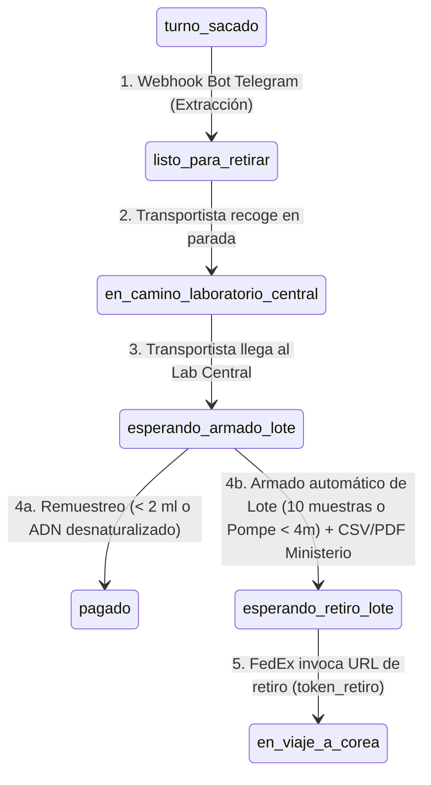

Used tool: invoke_subagent
Estoy analizando en detalle la estructura y el código del proyecto dentro de la carpeta `TTPS`, junto con el Glosario LEL, los Escenarios y la asignación de tareas de la Persona 4. En breve te presentaré el plan completo explicado paso a paso.
Analicé todo el repositorio `TTPS`, el Glosario LEL, los Escenarios y la tabla de tareas de la **Persona 4 (28 puntos)**.

---
## 1. Estado actual del proyecto (Qué ya está hecho y cómo funciona)

Antes de tocar código, es fundamental que entiendas qué dejaron listo en la base del proyecto:

1. **La Base de Datos y los Modelos ya están 100% creados:**
   - Todos los modelos SQLAlchemy 2.0 y los `ENUM` nativos de PostgreSQL para tus tareas **ya existen** en [enums.py](file:///c:/Users/Carlo/Documents/FACULTAD/4to-anio/TTPS/TTPS/backend/src/core/enums.py), [estudios/models.py](file:///c:/Users/Carlo/Documents/FACULTAD/4to-anio/TTPS/TTPS/backend/src/core/estudios/models.py), [turnos/models.py](file:///c:/Users/Carlo/Documents/FACULTAD/4to-anio/TTPS/TTPS/backend/src/core/turnos/models.py), [logistica/models.py](file:///c:/Users/Carlo/Documents/FACULTAD/4to-anio/TTPS/TTPS/backend/src/core/logistica/models.py) y [avisos/models.py](file:///c:/Users/Carlo/Documents/FACULTAD/4to-anio/TTPS/TTPS/backend/src/core/avisos/models.py).
   - **No necesitas crear tablas nuevas** (salvo que quieras agregar alguna columna opcional, y recuerda que según [base_de_datos.md](file:///c:/Users/Carlo/Documents/FACULTAD/4to-anio/TTPS/TTPS/docs/base_de_datos.md#L1-L22) no hay migraciones: se usa `reset-db` y `seed-db`).
2. **Autenticación y Permisos ya funcionan:**
   - En [security.py](file:///c:/Users/Carlo/Documents/FACULTAD/4to-anio/TTPS/TTPS/backend/src/web/security.py#L44-L56) tienes el decorador `@require_permission("modulo_accion")` y en [seed_permisos.py](file:///c:/Users/Carlo/Documents/FACULTAD/4to-anio/TTPS/TTPS/backend/src/core/seeds/seed_permisos.py#L16-L96) ya están cargados casi todos los permisos de tus pantallas.
3. **Arquitectura MVC estricta (Reglas del equipo en [README.md](file:///c:/Users/Carlo/Documents/FACULTAD/4to-anio/TTPS/TTPS/README.md#L40-L50)):**
   - **Controladores** (`backend/src/web/controllers/`): Solo leen el request, validan entrada/permisos y llaman al servicio. **Nunca** tienen lógica de negocio ni devuelven modelos de SQLAlchemy directos.
   - **Servicios** (`backend/src/core/<dominio>/service.py`): Tienen toda la lógica de negocio y consultas a la base de datos. **Nunca** importan nada de `flask`.
   - **Vistas** (`backend/src/web/views/`): Funciones puras que convierten los objetos/modelos en diccionarios JSON para responder.
   - **Regla de Oro de Auditoría**: **Cada vez** que cambies `estudio.estado`, **debes** insertar una fila en `EstudioHistorialEstado` ([estudios/models.py](file:///c:/Users/Carlo/Documents/FACULTAD/4to-anio/TTPS/TTPS/backend/src/core/estudios/models.py#L53-L63)) indicando `estudio_id`, `estado_anterior`, `estado_nuevo` y `usuario_id` (`None` si fue automático del sistema o un webhook externo).

---

## 2. Mapa del flujo de estados que controla la Persona 4

Tu trabajo cubre todo el tramo físico/logístico de la muestra de sangre, desde que se extrae en el laboratorio tercerizado hasta que viaja a Corea por FedEx:

---

## 3. Orden de desarrollo recomendado (6 Fases)

Te recomiendo seguir este orden para **no bloquear a la Persona 3** (que necesita tu mapa de centros de extracción para sacar turnos) y poder probar tu propio flujo de punta a punta:

1. **Fase 0 — Datos de prueba (Seeds) y Helper de cambio de estado**
2. **Fase 1 — Unidad: Componente de mapa transversal (4 pts)** *(Desbloquea a Persona 3)*
3. **Fase 2 — Unidad: Extracción y Webhook de Telegram (4 pts)**
4. **Fase 3 — Unidad: Logística, Módulo 9 y Vista Móvil del Transportista (9 pts)**
5. **Fase 4 — Unidad: Muestra y Remuestreo (2 pts)**
6. **Fase 5 — Unidad: Lotes, Ministerio de Salud y Envío con FedEx / Módulo 10 (9 pts)**

A continuación tienes el detalle de **qué debes crear/modificar y por qué** en cada fase.

---

### Fase 0: Preparación, Seeds de Centros/Feriados y Helper de Estados

#### ¿Por qué es necesario?
En [seed_catalogos.py](file:///c:/Users/Carlo/Documents/FACULTAD/4to-anio/TTPS/TTPS/backend/src/core/seeds/seed_catalogos.py#L5-L7) solo se siembran las 24 provincias y las 5 patologías, pero **no hay centros de extracción (`CentroExtraccion`), ni feriados (`Feriado`), ni el perfil `Transportista`** del usuario demo `transportista@exoma.test`. Sin centros con latitud/longitud ni un transportista asignado a una provincia, no podrás ver el mapa ni generar órdenes del día.

#### ¿Qué debes hacer?
1. **Actualizar [seed_catalogos.py](file:///c:/Users/Carlo/Documents/FACULTAD/4to-anio/TTPS/TTPS/backend/src/core/seeds/seed_catalogos.py)**:
   - Agregar una lista de al menos 6–10 `CentroExtraccion` de ejemplo ([turnos/models.py](file:///c:/Users/Carlo/Documents/FACULTAD/4to-anio/TTPS/TTPS/backend/src/core/turnos/models.py#L14-L24)) distribuidos en 2 o 3 provincias (ej. Buenos Aires, CABA, Córdoba) con coordenadas reales (`latitud`, `longitud`, `direccion`, `provincia_id`).
   - Agregar algunos `Feriado` ([turnos/models.py](file:///c:/Users/Carlo/Documents/FACULTAD/4to-anio/TTPS/TTPS/backend/src/core/turnos/models.py#L26-L29)) del calendario nacional para probar la validación de días hábiles.
2. **Actualizar [seed_usuarios_demo.py](file:///c:/Users/Carlo/Documents/FACULTAD/4to-anio/TTPS/TTPS/backend/src/core/seeds/seed_usuarios_demo.py)**:
   - Cuando se crea `transportista@exoma.test` (línea 28), asociarle su fila en la tabla `Transportista` ([usuarios/models.py](file:///c:/Users/Carlo/Documents/FACULTAD/4to-anio/TTPS/TTPS/backend/src/core/usuarios/models.py#L94-L102)) vinculada por ejemplo a la provincia `"Buenos Aires"`.
3. **Crear función auxiliar de transición de estado en `backend/src/core/estudios/service.py`** (coordinar con quien toque `estudios`):
   - Una función `cambiar_estado_estudio(session, estudio, nuevo_estado, usuario_id=None)` que actualice `estudio.estado = nuevo_estado` y agregue automáticamente un registro en `EstudioHistorialEstado(estudio_id=estudio.id, estado_anterior=anterior, estado_nuevo=nuevo_estado, usuario_id=usuario_id)`. Así cumples siempre la regla de auditoría del [README.md](file:///c:/Users/Carlo/Documents/FACULTAD/4to-anio/TTPS/TTPS/README.md#L49).

---

### Fase 1: Componente de Mapa Transversal (4 puntos)

#### ¿Qué pide la consigna y los escenarios?
- Un componente de mapa reutilizable en React que sirva para **dos casos de uso**:
  1. **Selección de centros de extracción** (lo usa la **Persona 3** en el escenario *"Sacar el turno"* para que el paciente vea los centros en el mapa y elija uno).
  2. **Seguimiento de posición del transportista** (lo usas **vos** en el escenario *"Consultar la ubicación de una muestra"* para que el administrativo vea por dónde va el transportista que lleva la muestra).

#### ¿Qué debes modificar/crear y por qué?

1. **Instalar Leaflet en el Frontend ([frontend/package.json](file:///c:/Users/Carlo/Documents/FACULTAD/4to-anio/TTPS/TTPS/frontend/package.json))**:
   - Actualmente `package.json` no tiene ninguna librería de mapas. Instala `leaflet` y `react-leaflet` (`npm install leaflet react-leaflet`).
   - *Por qué*: Utiliza OpenStreetMap de forma gratuita, sin requerir API Keys ni tarjeta de crédito, y permite renderizar marcadores y rutas fácilmente.

2. **Crear `frontend/src/components/Mapa.jsx` (y sus estilos en [app.css](file:///c:/Users/Carlo/Documents/FACULTAD/4to-anio/TTPS/TTPS/frontend/src/styles/app.css))**:
   - Diseña un componente `<Mapa />` flexible que reciba por `props`:
     - `centros`: array de `{ id, nombre, direccion, latitud, longitud, recogido }` para mostrar pines de laboratorios.
     - `centroSeleccionadoId` y `onSeleccionarCentro(centro)`: para que cuando la Persona 3 lo use en *"Sacar turno"*, al hacer clic en un pin se seleccione ese centro.
     - `transportista`: objeto opcional `{ nombre, latitud, longitud, provincia }` para mostrar un marcador especial (ícono de camión/transportista con el estilo de [DESIGN.md](file:///c:/Users/Carlo/Documents/FACULTAD/4to-anio/TTPS/TTPS/frontend/docs/diseno/DESIGN.md)).
     - `recorrido`: opcionalmente dibujar una polilínea (`Polyline`) uniendo las paradas de la orden del día.
   - Puedes agregar una demostración del `<Mapa />` en [Design.jsx](file:///c:/Users/Carlo/Documents/FACULTAD/4to-anio/TTPS/TTPS/frontend/src/design/Design.jsx) para que la Persona 3 vea exactamente cómo importarlo y pasarle props.

3. **Endpoint de Centros de Extracción (si no lo creó Persona 3)**:
   - En [seed_permisos.py](file:///c:/Users/Carlo/Documents/FACULTAD/4to-anio/TTPS/TTPS/backend/src/core/seeds/seed_permisos.py#L19) ya existe el permiso `"centro_listar"` para `paciente` y `administrativo`.
   - Un endpoint `GET /api/centros-extraccion` (con filtro opcional `?provincia_id=...`) que devuelva los centros activos con su `id`, `nombre`, `direccion`, `latitud`, `longitud` y `provincia`.

---

### Fase 2: Unidad Extracción — Webhook del Bot de Telegram (4 puntos)

#### ¿Qué pide la consigna y el escenario *"Registrar la extracción"*?
- Los centros de extracción son laboratorios tercerizados que **no operan en el sistema**. Cuando le sacan sangre al paciente, envían un mensaje al bot de Telegram del laboratorio central.
- El sistema recibe ese mensaje mediante un **Webhook**, identifica el estudio que estaba en estado `turno_sacado`, cambia el turno a `asistido` y actualiza automáticamente el estudio al estado `listo_para_retirar`.

#### ¿Qué debes modificar/crear y por qué?

1. **Variables de configuración ([backend/.env.example](file:///c:/Users/Carlo/Documents/FACULTAD/4to-anio/TTPS/TTPS/backend/.env.example) y [backend/src/config.py](file:///c:/Users/Carlo/Documents/FACULTAD/4to-anio/TTPS/TTPS/backend/src/config.py))**:
   - Agregar `TELEGRAM_WEBHOOK_SECRET` (y opcionalmente `TELEGRAM_BOT_TOKEN`).
   - *Por qué*: Como un webhook lo llama un servidor externo (Telegram o un simulador) y **no tiene sesión de usuario logueado** (`@require_auth` fallaría), se protege verificando el header estándar de Telegram `X-Telegram-Bot-Api-Secret-Token` (o en modo `mock`/`development` permitiendo dispararlo desde un endpoint o script de simulación).

2. **Servicio de recepción en `backend/src/core/logistica/service.py` (o `turnos/service.py`)**:
   - Crear la función `registrar_extraccion_telegram(session, identificador)`:
     - Busca el `Estudio` en estado `EstadoEstudio.turno_sacado` (puede buscarlo por `estudio.id`, por DNI del paciente o por código de turno incluido en el texto del mensaje de Telegram, ej. `/extraido <estudio_id_o_dni>`).
     - Verifica que esté en estado `EstadoEstudio.turno_sacado` (si no, lanza `ApiError(409, "ESTADO_INVALIDO", ...)`).
     - Busca su `Turno` reservado ([turnos/models.py](file:///c:/Users/Carlo/Documents/FACULTAD/4to-anio/TTPS/TTPS/backend/src/core/turnos/models.py#L32-L44)) y lo pasa a `EstadoTurno.asistido`.
     - Cambia el `Estudio` a `EstadoEstudio.listo_para_retirar` y registra la fila en `EstudioHistorialEstado` con `usuario_id=None` (acción automática del sistema).

3. **Controlador y Vista en `backend/src/web/controllers/webhooks.py` (o `logistica.py`)**:
   - Crear `POST /api/webhooks/telegram`:
     - Lee el JSON que envía Telegram (ej. `{"message": {"text": "..."}}` o un payload simplificado para pruebas `{"estudio_id": "..."}`).
     - Parsea el identificador, llama a `registrar_extraccion_telegram(...)` y devuelve el estado actualizado mediante una vista.
   - **Tip clave para la defensa/entrega**: Agrega también un botón de **"Simular mensaje de Telegram (Extracción realizada)"** en modo desarrollo o en el detalle de estudios/turnos cuando `ADAPTERS_MODE=mock`, o documenta cómo configurar el webhook real con BotFather (`setWebhook`). Así durante la demostración podrán pasar un estudio a `listo_para_retirar` tanto desde Telegram real como con un clic.

---

### Fase 3: Unidad Logística — Orden del Día, Módulo 9, Vista Móvil y GPS (9 puntos)

#### ¿Qué pide la consigna y los escenarios?
1. **Generar la orden del día**: Cada día hábil (lunes a viernes, verificando que la fecha no esté en la tabla `Feriado`), el sistema agrupa por provincia los centros que tienen muestras en estado `listo_para_retirar`, consulta al **Módulo 9 (optimización de recorridos)** enviándole las direcciones/coordenadas, y con el orden devuelto crea la `OrdenDelDia` ([logistica/models.py](file:///c:/Users/Carlo/Documents/FACULTAD/4to-anio/TTPS/TTPS/backend/src/core/logistica/models.py#L40-L49)), sus paradas `OrdenParada` (con `posicion = 1, 2, ...`) y los vínculos `ParadaEstudio` para el `Transportista` de esa provincia.
2. **Vista móvil del transportista (`/transportista/orden-del-dia`)**: Diseñada específicamente para celular (ancho de referencia `390px`, tarjetas apiladas, botones de ancho completo `>= 44px`, según [DESIGN.md](file:///c:/Users/Carlo/Documents/FACULTAD/4to-anio/TTPS/TTPS/frontend/docs/diseno/DESIGN.md#L84)).
3. **Recoger las muestras de un centro**: El transportista marca una parada como recogida -> se guarda `OrdenParada.recogida_at = now()` y todos los `Estudio` de esa parada pasan a `en_camino_laboratorio_central`.
4. **Entregar las muestras en el laboratorio central**: Cuando el transportista termina su recorrido y llega al laboratorio central -> se guarda `OrdenDelDia.llegada_central_at = now()`, todos los estudios en tránsito de esa orden pasan a `esperando_armado_lote`, y **se ejecuta automáticamente el armado de lotes** (Fase 5).
5. **Consultar la ubicación de una muestra en el mapa**: Cuando un estudio está `en_camino_laboratorio_central`, el administrativo entra al estudio y ve en el `<Mapa />` la ubicación actual (GPS simulado) del transportista que lo lleva.

#### ¿Qué debes modificar/crear y por qué?

1. **Adaptador del Módulo 9 (`backend/src/core/logistica/recorrido_adapter.py`)**:
   - Siguiendo el patrón `ADAPTERS_MODE=mock|real` de [config.py](file:///c:/Users/Carlo/Documents/FACULTAD/4to-anio/TTPS/TTPS/backend/src/config.py#L9):
     - En modo `real`: hace la petición HTTP a la API del Módulo 9 (configurada con `MODULO_RECORRIDO_API_URL` en `.env`) enviando las paradas de la provincia y recibiendo la lista ordenada.
     - En modo `mock`: ordena los centros de forma determinista (por ejemplo, por cercanía geográfica simple usando `latitud`/`longitud` —vecino más cercano—) para que siempre funcione sin depender de que el otro grupo tenga su servidor prendido.

2. **Servicio de Logística (`backend/src/core/logistica/service.py`)**:
   - `es_dia_habil(session, fecha: date) -> bool`: Verifica que `fecha.weekday() < 5` (lunes a viernes) y que no exista en la tabla `Feriado` ([turnos/models.py](file:///c:/Users/Carlo/Documents/FACULTAD/4to-anio/TTPS/TTPS/backend/src/core/turnos/models.py#L26-L29)).
   - `generar_ordenes_del_dia(session, fecha: date, adapter)`:
     - Valida que `fecha` sea día hábil (si es fin de semana o feriado, lanza error o no genera).
     - Busca todos los `Estudio` en estado `listo_para_retirar` junto con su último `Turno` (`EstadoTurno.asistido`) para saber en qué `CentroExtraccion` y `provincia_id` está cada muestra.
     - Agrupa por `provincia_id`. Para cada provincia, busca su `Transportista` ([usuarios/models.py](file:///c:/Users/Carlo/Documents/FACULTAD/4to-anio/TTPS/TTPS/backend/src/core/usuarios/models.py#L94-L102)).
     - Llama al `recorrido_adapter` con los centros de esa provincia.
     - Crea la `OrdenDelDia`, las filas de `OrdenParada` con `posicion=1..N` y las filas de `ParadaEstudio` vinculando cada estudio con su parada.
   - `obtener_orden_del_dia_actual(session, transportista_id, fecha)`: Devuelve la orden del día del transportista con sus paradas, direcciones, coordenadas y cantidad de muestras por parada.
   - `marcar_parada_recogida(session, transportista_id, parada_id)`:
     - Verifica que la parada pertenezca a la orden del transportista y no haya sido recogida aún (y opcionalmente que respete el orden inalterable de paradas).
     - Setea `parada.recogida_at = now()`.
     - Pasa todos los `Estudio` asociados en `ParadaEstudio` al estado `EstadoEstudio.en_camino_laboratorio_central` (registrando en `EstudioHistorialEstado` con `usuario_id=transportista_id`).
   - `registrar_llegada_laboratorio_central(session, transportista_id, orden_id)`:
     - Verifica que las paradas recogidas estén listas para entregar y setea `orden.llegada_central_at = now()`.
     - Pasa todos los estudios recogidos de esa orden al estado `EstadoEstudio.esperando_armado_lote` (con su historial).
     - **Llama inmediatamente a `intentar_armar_lotes(session)`** (de la Fase 5) para cumplir el episodio 4 del escenario *"Entregar las muestras en el laboratorio central"*.
   - `obtener_ubicacion_muestra(session, estudio_id)` (**GPS Simulado**):
     - Verifica que el estudio esté en `en_camino_laboratorio_central`.
     - A través de `ParadaEstudio -> OrdenParada -> OrdenDelDia -> Transportista`, obtiene quién lo lleva y todas las paradas de su orden del día.
     - **¿Cómo simular el GPS de forma inteligente y sin tablas extra?**: Interpolando las coordenadas entre la última `OrdenParada` que tiene `recogida_at IS NOT NULL` y la siguiente parada pendiente (o las coordenadas del Laboratorio Central si ya recogió la última parada). También puedes permitir que desde la vista móvil del transportista o un parámetro se actualice su coordenada simulada.

3. **Controladores y Vistas (`backend/src/web/controllers/logistica.py` y `backend/src/web/views/logistica_view.py`)**:
   - `POST /api/logistica/ordenes-del-dia/generar`: Protegido por `INTERNAL_JOBS_TOKEN` (para cron) **o** por permiso de administrativo (agrega `"orden_dia_generar"` a `RolUsuario.administrativo` en [seed_permisos.py](file:///c:/Users/Carlo/Documents/FACULTAD/4to-anio/TTPS/TTPS/backend/src/core/seeds/seed_permisos.py#L62-L82) para poder dispararlo con un botón desde la interfaz).
   - `GET /api/transportista/orden-del-dia`: `@require_permission("orden_dia_ver")`.
   - `POST /api/transportista/paradas/<parada_id>/recoger`: `@require_permission("orden_dia_recoger")`.
   - `POST /api/transportista/ordenes/<orden_id>/entregar`: `@require_permission("orden_dia_entregar")`.
   - `GET /api/estudios/<estudio_id>/ubicacion`: `@require_permission("estudio_ubicacion_ver")`.
   - Registrar el blueprint en [backend/src/web/controllers/__init__.py](file:///c:/Users/Carlo/Documents/FACULTAD/4to-anio/TTPS/TTPS/backend/src/web/controllers/__init__.py).

4. **Frontend — Vista Móvil del Transportista (`frontend/src/pages/transportista/OrdenDelDia.jsx`)**:
   - Reemplazar la ruta provisoria `/transportista/orden-del-dia` en [frontend/src/App.jsx](file:///c:/Users/Carlo/Documents/FACULTAD/4to-anio/TTPS/TTPS/frontend/src/App.jsx#L34-L36).
   - Seguir [DESIGN.md](file:///c:/Users/Carlo/Documents/FACULTAD/4to-anio/TTPS/TTPS/frontend/docs/diseno/DESIGN.md#L84): contenedor centrado `max-width: 390px` (o fluido en móvil), tarjetas apiladas mostrando el número de parada (`#1`, `#2`...), nombre y dirección del centro de extracción, cantidad de tubos a retirar, y un `<Boton>` de ancho completo (`width: 100%`, alto `>= 46px`) **"Marcar centro como recogido"**.
   - Al final de la lista de paradas, mostrar el botón primario **"Registrar llegada al laboratorio central"** (habilitado cuando ya recogió las muestras).
   - Incluir arriba o en un desplegable tu componente `<Mapa />` mostrando la ruta del día.

---

### Fase 4: Unidad Muestra y Remuestreo (2 puntos)

#### ¿Qué pide la consigna y los escenarios *"Registrar el volumen de la muestra"* y *"Notificar el remuestreo"*?
- Cuando la muestra llega al laboratorio central (estado `esperando_armado_lote`), el administrativo revisa el tubo físico y registra los mililitros (`volumen_ml`) o indica si sufrió un percance (desnaturalización del ADN).
- Si el volumen es **menor a 2 ml** (`volumen_ml < 2.0`) o hubo desnaturalización/percance:
  1. Se notifica al paciente que debe realizarse un **remuestreo gratuito** (creando un `Aviso` interno con `TipoAviso.remuestreo` y enviando un mail con `MailSender`).
  2. El estudio vuelve automáticamente al estado `EstadoEstudio.pagado` (lo que le permite al paciente volver a entrar a *"Sacar el turno"* sin tener que pagar de nuevo).

#### ¿Qué debes modificar/crear y por qué?

1. **Servicio en `backend/src/core/logistica/service.py` (o `estudios/service.py`)**:
   - Crear `registrar_control_muestra(session, estudio_id, volumen_ml: Decimal, percance: bool, motivo: str | None, usuario_id, mail_sender)`:
     - Verifica que el estudio esté en `EstadoEstudio.esperando_armado_lote`.
     - Guarda `estudio.volumen_ml = volumen_ml` ([estudios/models.py](file:///c:/Users/Carlo/Documents/FACULTAD/4to-anio/TTPS/TTPS/backend/src/core/estudios/models.py#L34)).
     - **Caso A (`volumen_ml < Decimal("2.0")` o `percance == True`)**:
       - Cambia el estado del estudio a `EstadoEstudio.pagado` (registrando en `EstudioHistorialEstado`).
       - Si el estudio ya hubiera sido preasignado a algún lote no sellado, le quita `estudio.lote_id = None`.
       - Crea un `Aviso` ([avisos/models.py](file:///c:/Users/Carlo/Documents/FACULTAD/4to-anio/TTPS/TTPS/backend/src/core/avisos/models.py#L12-L25)) para `estudio.paciente_id` con `tipo=TipoAviso.remuestreo`, título `"Se requiere una nueva muestra de sangre"` y el mensaje explicando que puede sacar un nuevo turno sin cargo.
       - Envía un correo usando `mail_sender` ([mail_service.py](file:///c:/Users/Carlo/Documents/FACULTAD/4to-anio/TTPS/TTPS/backend/src/core/avisos/mail_service.py)).
     - **Caso B (`volumen_ml >= Decimal("2.0")` y sin percance)**:
       - Mantiene el estudio válido en `esperando_armado_lote` (y si deciden en equipo que un estudio solo entra a un lote una vez medido su volumen `>= 2 ml`, dispara `intentar_armar_lotes(session)` aquí también).

2. **Controlador (`POST /api/estudios/<estudio_id>/muestra`)**:
   - Protegido con `@require_permission("remuestreo_notificar")` (ya existe en [seed_permisos.py](file:///c:/Users/Carlo/Documents/FACULTAD/4to-anio/TTPS/TTPS/backend/src/core/seeds/seed_permisos.py#L77) para `administrativo`).
   - Recibe `{"volumen_ml": 1.5, "percance": false, "motivo": "Volumen insuficiente (< 2 ml)"}`.

3. **Frontend (en el panel de Administrativo)**:
   - Un formulario/modal donde el administrativo selecciona un estudio en `esperando_armado_lote`, ingresa los mililitros del tubo (o marca "Muestra desnaturalizada / percance") y confirma. Si pone menos de `2`, la interfaz le advierte que se notificará el remuestreo y el estudio volverá a `Pagado`.

---

### Fase 5: Unidad Lotes y Envío — Armado Automático, Ministerio de Salud y FedEx / Módulo 10 (9 puntos)

#### ¿Qué pide la consigna y los escenarios?
1. **Armar el lote (Normal vs. Pompe Urgente)**:
   - **Normal**: Cuando hay **10 estudios** en estado `esperando_armado_lote` (sin `lote_id`), el sistema arma automáticamente un `Lote` con esas 10 muestras.
   - **Urgencia Pompe**: Si llega al laboratorio central un estudio que tiene `estudio.es_pompe_urgente == True` (sospecha de Pompe en un paciente menor de 4 meses), el sistema **no espera a llegar a 10**: arma inmediatamente un lote (`es_urgente = True`) con esa muestra y todas las demás que estén disponibles en `esperando_armado_lote` en ese momento (hasta un máximo de 10).
2. **CSV y PDF del Ministerio de Salud + Sellado**:
   - Al armar el lote, el sistema genera un archivo **CSV** con los datos de los pacientes del lote y lo envía a la **API del Ministerio de Salud**.
   - La API del Ministerio devuelve un **PDF de autorización**.
   - El sistema guarda `lote.csv_url` y `lote.autorizacion_pdf_url` (como cada `Estudio` tiene `lote_id` que apunta a `Lote`, ambos documentos quedan asociados a cada estudio del lote).
   - El sistema **sella el lote** (`lote.sellado_at = now()`) y actualiza el lote al estado `EstadoLote.esperando_retiro`. *(Nota importante de [logistica/models.py](file:///c:/Users/Carlo/Documents/FACULTAD/4to-anio/TTPS/TTPS/backend/src/core/logistica/models.py#L36): la tabla `lote` tiene un `CheckConstraint("sellado_at IS NULL OR autorizacion_pdf_url IS NOT NULL")`, por lo que siempre debes setear `autorizacion_pdf_url` antes o al mismo tiempo que `sellado_at`).*
3. **Programar el retiro del lote con FedEx (Módulo 10)**:
   - El administrativo selecciona un lote sellado en estado `esperando_retiro` y define fecha y hora de retiro (**lunes a viernes de 9 a 18 hs, sin feriados**).
   - El sistema envía a la **API de FedEx (Módulo 10)** el día, la hora y la **URL de callback del lote** (que usa `lote.token_retiro`, nunca el `id` interno, según [base_de_datos.md](file:///c:/Users/Carlo/Documents/FACULTAD/4to-anio/TTPS/TTPS/docs/base_de_datos.md#L45)).
   - Se guarda `lote.retiro_programado_at` (y `lote.fedex_url_seguimiento` si la devuelve la API).
4. **Registrar el retiro del lote (Callback de FedEx)**:
   - Cuando llega el momento y FedEx retira el lote (o invoca la URL `POST /api/webhooks/fedex/retiro/<token_retiro>`), el sistema cambia el `Lote` a `EstadoLote.en_viaje_a_corea` y cambia **todos los `Estudio` de ese lote** a `EstadoEstudio.en_viaje_a_corea` (registrando cada uno en `EstudioHistorialEstado`).

#### ¿Qué debes modificar/crear y por qué?

1. **Adaptadores de Ministerio de Salud y FedEx (`backend/src/core/logistica/ministerio_adapter.py` y `fedex_adapter.py`)**:
   - **Ministerio de Salud**:
     - Genera el contenido CSV en memoria (`dni,nombre,apellido,fecha_nacimiento,estudio_id`) con los pacientes de los estudios del lote.
     - En modo `mock`: guarda/genera una URL o data URI para el CSV y genera un PDF de autorización simulado (válido con cabecera `%PDF-1.4...`), devolviendo `(csv_url, autorizacion_pdf_url)`.
     - En modo `real`: hace `POST` del CSV a `MINISTERIO_SALUD_API_URL` y guarda el PDF devuelto.
   - **FedEx (Módulo 10)**:
     - Recibe `fecha_hora_retiro` y `callback_url` (ej. `f"{BACKEND_URL}/api/webhooks/fedex/retiro/{lote.token_retiro}"`).
     - En modo `mock`: valida los datos y devuelve una URL de seguimiento simulada.
     - En modo `real`: hace `POST` a `FEDEX_API_URL` (Módulo 10).

2. **Lógica de Armado de Lotes en `backend/src/core/logistica/service.py`**:
   - `intentar_armar_lotes(session, ministerio_adapter)`:
     - Consulta todos los `Estudio` con `estado == EstadoEstudio.esperando_armado_lote` y `lote_id.is_(None)`, ordenados poniendo primero los `es_pompe_urgente == True` y luego por `created_at` (FIFO).
     - Mientras haya al menos 10 estudios disponibles, **o** exista al menos 1 estudio con `es_pompe_urgente == True`:
       - Toma hasta 10 estudios (`muestras = disponibles[:10]`).
       - Determina `es_urgente = any(e.es_pompe_urgente for e in muestras)`.
       - Crea el `Lote(estado=EstadoLote.esperando_autorizacion_ministerio, es_urgente=es_urgente)` y asigna `estudio.lote_id = lote.id` a cada muestra.
       - Genera el CSV y solicita la autorización al `ministerio_adapter`.
       - Al recibir la autorización, actualiza `lote.csv_url`, `lote.autorizacion_pdf_url`, `lote.sellado_at = now()` y `lote.estado = EstadoLote.esperando_retiro`.

3. **Lógica de Programación y Retiro de FedEx en `backend/src/core/logistica/service.py`**:
   - `programar_retiro_fedex(session, lote_id, fecha_hora: datetime, fedex_adapter)`:
     - Verifica que `lote.estado == EstadoLote.esperando_retiro` y `lote.sellado_at is not None`.
     - Valida que `fecha_hora` sea de **lunes a viernes**, no sea `Feriado`, y el horario esté entre las **09:00 y las 18:00** (zona horaria `America/Argentina/Buenos_Aires`). Si no cumple, lanza `ApiError(422, "HORARIO_INVALIDO", ...)`.
     - Construye la URL con `lote.token_retiro` y llama a `fedex_adapter.programar_retiro(...)`.
     - Guarda `lote.retiro_programado_at = fecha_hora`.
   - `registrar_retiro_fedex_por_token(session, token_retiro: uuid.UUID)`:
     - Busca el `Lote` por `Lote.token_retiro == token_retiro`.
     - Verifica que esté en `EstadoLote.esperando_retiro`.
     - Actualiza `lote.estado = EstadoLote.en_viaje_a_corea`.
     - Para cada `estudio` en `lote.estudios`, llama a `cambiar_estado_estudio(session, estudio, EstadoEstudio.en_viaje_a_corea, usuario_id=None)`.

4. **Controladores y Vistas (`backend/src/web/controllers/lotes.py` y `backend/src/web/views/lotes_view.py`)**:
   - `GET /api/lotes`: `@require_permission("lote_listar")`. Lista los lotes con su estado, si es urgente, cantidad de muestras, links al CSV y PDF del Ministerio, `retiro_programado_at`, y estudios incluidos.
   - `POST /api/lotes/<lote_id>/programar-retiro`: `@require_permission("lote_programar_retiro")`.
   - `POST /api/webhooks/fedex/retiro/<token_retiro>`: Endpoint público (autenticado por la posesión del `token_retiro` UUID único e impredecible) que invoca FedEx al retirar el lote.

5. **Frontend — Pantalla de Gestión de Lotes (`frontend/src/pages/administrativo/Lotes.jsx`)**:
   - Reemplazar la ruta `/administrativo/lotes` en [frontend/src/App.jsx](file:///c:/Users/Carlo/Documents/FACULTAD/4to-anio/TTPS/TTPS/frontend/src/App.jsx#L34-L36) (el ítem ya existe en el menú lateral del administrativo en [roles.js](file:///c:/Users/Carlo/Documents/FACULTAD/4to-anio/TTPS/TTPS/frontend/src/constants/roles.js#L38)).
   - Mostrar:
     - Contador o lista de muestras actualmente en `Esperando armado de lote` (y sección para cargar los `ml` del tubo / reportar remuestreo de la Fase 4).
     - Tabla de Lotes usando el componente [Tabla.jsx](file:///c:/Users/Carlo/Documents/FACULTAD/4to-anio/TTPS/TTPS/frontend/src/components/Tabla.jsx) y [Chip.jsx](file:///c:/Users/Carlo/Documents/FACULTAD/4to-anio/TTPS/TTPS/frontend/src/components/Chip.jsx): mostrando ID, etiqueta si es **Urgente (Pompe < 4m)**, cantidad de muestras (`x/10`), enlaces para descargar/ver el **CSV** y el **PDF del Ministerio**, estado del lote (`Esperando retiro` / `En viaje a Corea`), y botón **"Programar retiro con FedEx"**.
     - En modo desarrollo (`ADAPTERS_MODE=mock`), incluir un botón **"Simular retiro de FedEx"** al lado de los lotes programados que dispare la URL del `token_retiro` para poder probar en vivo cómo el lote y sus estudios pasan a `En viaje a Corea`.

---

## 4. Resumen de Archivos que Crearás o Modificarás

| Capa | Archivo | Acción | Qué contiene |
|---|---|---|---|
| **Seeds** | [seed_catalogos.py](file:///c:/Users/Carlo/Documents/FACULTAD/4to-anio/TTPS/TTPS/backend/src/core/seeds/seed_catalogos.py) | Modificar | Sembrar `CentroExtraccion` (con lat/lng) y `Feriado`. |
| **Seeds** | [seed_usuarios_demo.py](file:///c:/Users/Carlo/Documents/FACULTAD/4to-anio/TTPS/TTPS/backend/src/core/seeds/seed_usuarios_demo.py) | Modificar | Crear el perfil `Transportista` para `transportista@exoma.test`. |
| **Config** | [config.py](file:///c:/Users/Carlo/Documents/FACULTAD/4to-anio/TTPS/TTPS/backend/src/config.py) y [.env.example](file:///c:/Users/Carlo/Documents/FACULTAD/4to-anio/TTPS/TTPS/backend/.env.example) | Modificar | URLs/keys de Módulo 9 (Recorridos), Módulo 10 (FedEx), Ministerio de Salud y Telegram. |
| **Backend Core** | `backend/src/core/logistica/adapters.py` | Crear | Adaptadores `mock` y `real` para Módulo 9 (recorridos), Ministerio de Salud (CSV -> PDF) y Módulo 10 (FedEx). |
| **Backend Core** | `backend/src/core/logistica/service.py` | Crear | Toda la lógica de negocio: webhook Telegram, orden del día, recoger parada, llegada a central, control de `volumen_ml` y remuestreo, armado automático/urgente de lotes, y programación/retiro FedEx. |
| **Backend Web** | `backend/src/web/controllers/logistica.py` | Crear | Endpoints REST de transportista, lotes, muestras, ubicación y webhooks (registrado en [controllers/__init__.py](file:///c:/Users/Carlo/Documents/FACULTAD/4to-anio/TTPS/TTPS/backend/src/web/controllers/__init__.py)). |
| **Backend Web** | `backend/src/web/views/logistica_view.py` | Crear | Serializadores JSON para órdenes del día, paradas, ubicación GPS, lotes y centros. |
| **Tests** | `backend/tests/logistica/test_logistica.py` | Crear | Tests con `pytest` probando los 5 puntos (Telegram -> Orden del día -> Recoger -> Llegada -> Remuestreo < 2ml -> Lote de 10 y Pompe urgente -> Retiro FedEx). |
| **Frontend** | `frontend/src/components/Mapa.jsx` | Crear | Componente transversal de mapa con Leaflet (centros de extracción para Persona 3 + tracking de transportista para vos). |
| **Frontend** | `frontend/src/pages/transportista/OrdenDelDia.jsx` | Crear | Vista móvil (`390px`) del transportista para ver paradas, marcar recogido y llegada al lab central. |
| **Frontend** | `frontend/src/pages/administrativo/Lotes.jsx` | Crear | Pantalla de administrativo para registrar volumen de muestras/remuestreo, ver lotes, CSV/PDF del Ministerio, programar FedEx y ver ubicación de muestra en el mapa. |
| **Frontend** | [App.jsx](file:///c:/Users/Carlo/Documents/FACULTAD/4to-anio/TTPS/TTPS/frontend/src/App.jsx) | Modificar | Conectar las rutas `/transportista/orden-del-dia` y `/administrativo/lotes` a tus nuevas pantallas. |

---

## 5. Puntos a coordinar con tus otros 3 compañeros

1. **Con la Persona 3 (Turnos y Centros de Extracción)**:
   - Avísale apenas tengas listo `<Mapa />` (`frontend/src/components/Mapa.jsx`) y el endpoint `GET /api/centros-extraccion`, acordando qué `props` recibe el componente (por ejemplo: `<Mapa centros={centros} seleccionadoId={id} onSeleccionar={setCentro} />`).
2. **Con quien haga Administrativo -> Estudios (`/administrativo/estudios`)**:
   - Pregúntale si prefiere que el botón **"Ver ubicación en mapa"** (cuando el estudio está `en_camino_laboratorio_central`) y el formulario de **"Registrar mililitros del tubo / Remuestreo"** (cuando está `esperando_armado_lote`) estén dentro de un modal en `/administrativo/estudios`, o si los pones directamente en una pestaña dentro de tu pantalla `/administrativo/lotes` (o en ambos lados).
3. **Con quien haga Administrativo -> Transportistas (`/administrativo/transportistas`)**:
   - Verifica en la tabla de tus compañeros a quién le tocó el escenario *"Registrar el transportista"*. Si te tocó a vos dentro de Logística, es simplemente un formulario en `/administrativo/transportistas` que llama a `POST /api/transportistas` creando el `Usuario(rol=RolUsuario.transportista, debe_cambiar_password=True)` y su fila en `Transportista(usuario_id=..., provincia_id=...)`.

¿Te gustaría que profundicemos en alguna de las fases primero (por ejemplo, mostrándote el código exacto que debes escribir para la **Fase 0 y Fase 1** o cómo estructurar `logistica/service.py`), o tienes alguna duda sobre cómo funciona alguna regla de negocio?